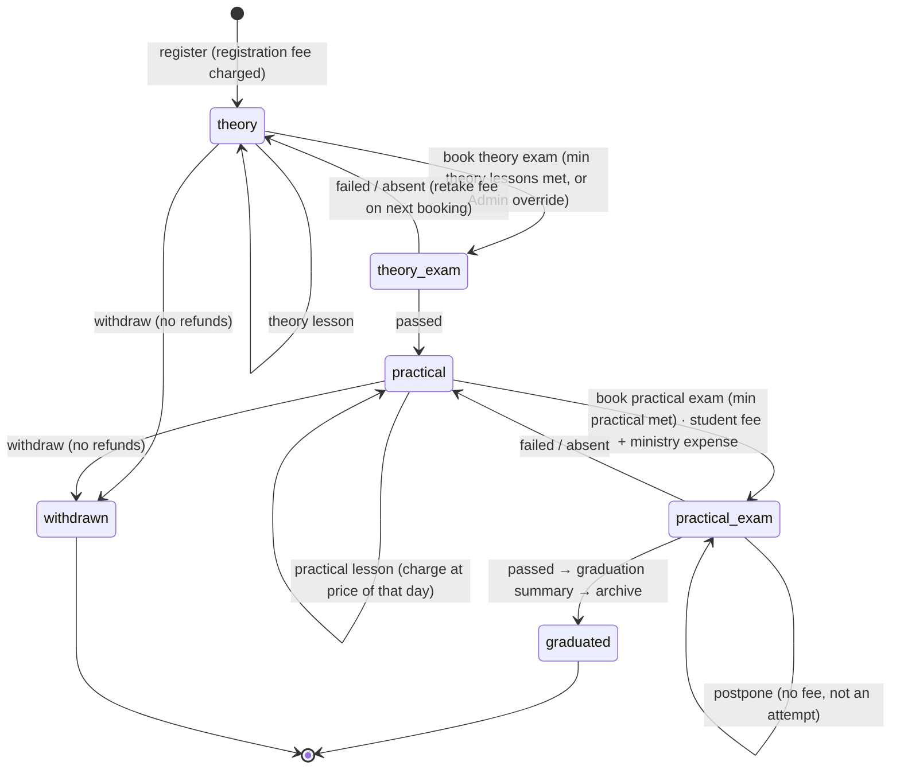

# 03 · Enrollment states & key flows

## Enrollment state machine


If the license type has "practical after theory" off, practical lessons may start in `theory`.

## Flow: log a practical lesson offline (two instructors on different cars)

```mermaid
sequenceDiagram
  participant I1 as Instructor phone A
  participant I2 as Instructor phone B
  participant S as applyOps
  I1->>I1: tap "practical 8" for Sara → lesson + charge(price on businessDate) + outbox; timer starts (exact alarm)
  I2->>I2: tap "practical 4" for Mohammad → same
  Note over I1,I2: both offline
  I1->>S: push (later)
  S-->>I1: accepted · number 8 · charge ₪120 · notify Sara "lesson started"
  I2->>S: push
  S-->>I2: accepted · number 4
```
Same-student race (rare): both phones show "8" provisionally; server accepts both in order → 8 and 9; phones adopt final numbers.

## Flow: registration → first payment → WhatsApp
1. RegisterStudent: search by national ID (existing → add enrollment instead of duplicate).
2. One transaction: student + enrollment + `registration_fee` charge (price effective today) + log.
3. Payment sheet opens pre-filled (student, suggested amount) → `payment` + treasury `in` + receipt `deviceCode-counter`.
4. WhatsApp: credentials + download link (+ receipt). SMS automatically in `direct`, via intent in `play`.

## Flow: book exam (one tap does three things)
`exam(booked)` + student `exam_fee`/`retake_fee` charge + `expense(ministry)` from chosen account + notification. Result buttons only from `scheduledDate`. Postpone: `exam_postponement` + new date, fee untouched.

## Flow: end of day (blind or full)
1. Counts typed per allowed account → (blind: "submit count" locks amounts) → matched / difference + mandatory reason.
2. `day_close` + `day_close_count` rows; day becomes read-only.
3. Later ops for that businessDate (offline phones) are accepted, flagged `lateAfterClose`, day shows "entries arrived after closing", Admin notified.
4. Month lock only when every day of the month is closed → snapshot frozen.

## Flow: payroll month
Advances (cash out immediately) · deductions/bonuses (no cash) · pay → `salary_payment` (net, from account) closes the month's advances; advances > net → carryOver to next month. Locked months read-only.

## Flow: sync after a long offline period
Push in deviceSeq order (≤ 50 per call) → each result applied → then pull per collection by cursor (500 per page) → summaries replaced → pending deltas re-applied on top → "synced · 0 pending". Rejected ops listed with reason + suggested fix.
