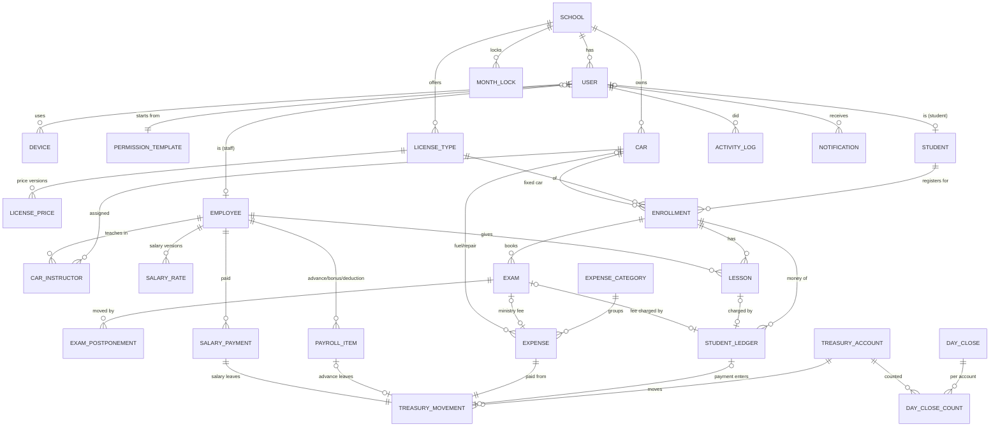

# 04 · Data model (ERD + dictionary)

Status: **draft for Reem's review**. Same entities on the phone (Drift tables) and the server (Firestore collections under `schools/{schoolId}/…`).

Conventions for every table/collection (not repeated below):
`id` (UUIDv7, created on the phone) · `schoolId` · `createdBy` · `deviceTime` · `serverTime` · `serverSeq` · `syncState` (phone only: pending/synced/rejected) · `archived` (bool) + `archivedReason` where records can be archived.
Money = **integer agorot** (`int`, ₪1 = 100). Dates: `businessDate` = `YYYY-MM-DD` (the day it happened); timestamps UTC.

## ERD

## Dictionary

### Identity & access
| Table | Key fields |
|---|---|
| `school` | name, logoUrl, logoVersion, settingsVersion, currency `ILS`, timezone `Asia/Hebron`, receiptPrefix |
| `user` | name, nationalId (unique per school), phone, kind (`admin`/`staff`/`instructor`/`student`), templateId, **permissions** (map of task keys → bool + options: allowedAccounts[], expenseCategories[], discountMax, closeMode `blind/full`, logScope `own/all`), permVersion, status (`active`/`disabled`), language (`ar`/`en`), theme (`system/light/dark`), studentId?, employeeId? |
| `permission_template` | name (محاسب، سكرتاريا، مدرب، مدير…), permissions (same shape), builtIn |
| `device` | userId, deviceCode (short number used in receipt numbers), model, appVersion, flavor, lastSeenAt, pendingOpsCount (reported on sync) |

### Catalog & settings
| Table | Key fields |
|---|---|
| `license_type` | name (خصوصي، عمومي، دراجة…), active, sortOrder |
| `license_price` | licenseTypeId, **effectiveFrom**, registrationFee, practicalLessonPrice, theoryRetakeFee, practicalExamFee, plannedTheoryLessons, plannedPracticalLessons, minTheoryBeforeExam, minPracticalBeforeExam, practicalAfterTheory (bool) |
| `setting` | key, value, effectiveFrom — lessonDurationMin, withoutDrivingEnabled, closeReminderHour, overdueAmount, overdueDays, backupEmail, lowBalanceThreshold per account… |
| `expense_category` | kind (`cars`/`ministry`/`salaries`/`other`), name, active |
| `treasury_account` | name, kind (`cash`/`wallet`/`bank`), openingBalance, openingDate, active |
| `car` | name, plate, gearbox (`manual`/`auto`), active |
| `car_instructor` | carId, employeeId, from, to? |

### Students & learning
| Table | Key fields |
|---|---|
| `student` | name, nationalId, phone, language, userId |
| `enrollment` | studentId, studentName (denormalized so instructors never need the student doc with national ID/phone; updated by the edit-student op), licenseTypeId, carId (fixed), stage (`theory`/`practical`/`ready_practical`/`graduated`/`withdrawn`), registeredOn, graduatedOn?, withdrawnOn?, withdrawReason? |
| `lesson` | enrollmentId, type (`theory`/`practical`), **number** (server-final; provisional on phone), withoutDriving (bool), employeeId (instructor), carId (practical only), startedAt, durationMin, businessDate. *No price here.* |
| `exam` | enrollmentId, type (`theory`/`theory_retake`/`practical`), attempt, scheduledDate, result (`pending`/`passed`/`failed`/`absent`), resultBy?, feeLedgerId?, ministryExpenseId? |
| `exam_postponement` | examId, fromDate, toDate, reason (`ministry`/`student`/`car`/`other`), details |

### Money
| Table | Key fields |
|---|---|
| `student_ledger` | enrollmentId, studentId, **kind** (`registration_fee`/`lesson_charge`/`exam_fee`/`retake_fee`/`payment`/`discount`/`reversal`), amount (positive; kind decides direction), lessonId?, examId?, accountId? (payments), purpose? (`lessons`/`registration`/`exam`/`general`), receiptNo? (`deviceCode-counter`), reversesId?, priceVersionId? (charges), businessDate |
| `treasury_movement` | accountId, direction (`in`/`out`), amount, kind (`student_payment`/`expense`/`advance`/`salary`/`top_up`/`withdraw`/`transfer_in`/`transfer_out`), refId, transferGroupId?, businessDate |
| `expense` | categoryId, carId?, liters? (fuel), employeeId?, examId?, studentId?, amount, accountId, note, businessDate |

### Payroll
| Table | Key fields |
|---|---|
| `employee` | name, role (`instructor`/`staff`), userId?, active |
| `salary_rate` | employeeId, effectiveFrom, monthlyAmount |
| `payroll_item` | employeeId, payrollMonth (`YYYY-MM`), kind (`advance`/`deduction`/`bonus`), reason, amount, accountId? (advance only), businessDate |
| `salary_payment` | employeeId, payrollMonth, salaryAtMonth, bonuses, deductions, advances, net, carryOver, accountId, businessDate, early (bool) |

### Closing, audit, notifications
| Table | Key fields |
|---|---|
| `day_close` | businessDate, state (`closed`/`reopened`), mode (`blind`/`full`), closedBy, lateEntries (count), reopenReason? |
| `day_close_count` | dayCloseId, accountId, expected, counted, diff, reason? |
| `month_lock` | month, lockedBy, snapshotRef |
| `activity_log` | opId, actorId, deviceId, opType (`create`/`edit`/`archive`/`restore`/`postpone`/`settings`/`permission`/`close`/`reopen`/`login`…), entity, recordId, recordLabel, **changes** [{field, old, new}], reason?, lateAfterClose? — rendered as "المدير غيّر … من A إلى B" |
| `notification` | userId, type, title, body, link, readAt? |

### Phone-only tables
`outbox` (opId, type, payload JSON, deviceSeq, attempts, lastError) · `rejected_op` (opId, reason, suggestion, payload) · `sync_cursor` (collection, lastSeq) · `kv` · `device_local` (deviceCode, receiptCounter, clockOffset).

### Server-only
`ops/{opId}` (result, for idempotency) · summaries (`student_summary`, `account_balance`, `day_summary`, `month_snapshot`, `payroll_month`) · `meta/head` (latest serverSeq, settingsVersion).

## Indexes (Drift and Firestore composite)
- `lesson(enrollmentId, startedAt)`, `lesson(employeeId, businessDate)`, `lesson(carId, businessDate)`
- `student_ledger(enrollmentId, businessDate)`, `student_ledger(kind, businessDate)`
- `treasury_movement(accountId, businessDate)`, `treasury_movement(businessDate)`
- `expense(categoryId, businessDate)`, `expense(carId, businessDate)`
- `exam(scheduledDate, result)`, `payroll_item(employeeId, payrollMonth)`
- every synced collection: `(schoolId, serverSeq)`; instructor scope: `(carId, serverSeq)`

## Derived values (never stored as editable numbers)
- **Student remaining** = Σ charges − Σ payments − Σ discounts (reversals cancel their target).
- **Account balance** = openingBalance + Σ in − Σ out.
- **Lesson N** = order of accepted, non-archived lessons of that type in the enrollment.
- **Payroll net** = salary_rate at month + bonuses − deductions − advances; negative → carryOver to next month.
- **Fuel per lesson** = car fuel expenses ÷ practical lessons with driving (excludes "without driving").
