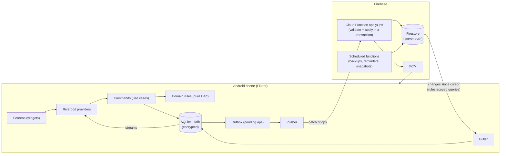
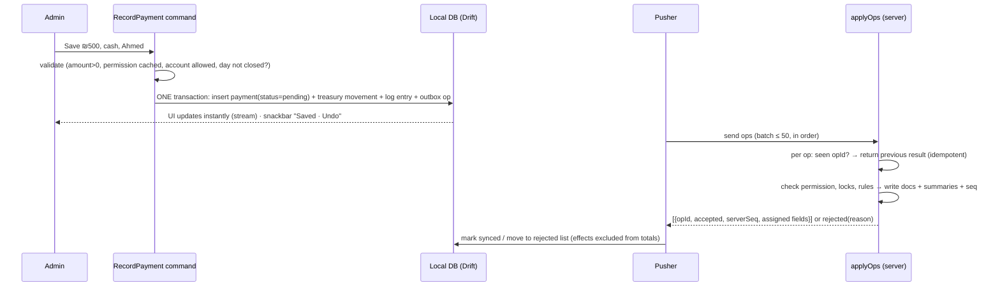

# 05 · Architecture & offline sync

Status: **draft for Reem's review** · Decisions referenced as P#/D#/Q# from `DECISIONS.md`.

## 1. Big picture



Rules that never bend:
1. **Screens read only from the local DB.** Never from the network, never wait for it.
2. **Every write is an operation** (append-only, client UUIDv7 id) saved locally *and* queued in the outbox **in one local transaction**.
3. **Clients never write to Firestore directly.** Security rules deny all client writes; the only write path is `applyOps`. One place for permissions, locks and business rules.
4. **The server is the referee:** it assigns server time and a per-school sequence number, accepts or rejects each op, and maintains summaries.

## 2. Layers and modules

| Layer | Contains | Depends on |
|---|---|---|
| presentation | widgets, screens, design system, l10n | providers |
| application | Riverpod providers, **commands** (one per user action: `RecordPayment`, `LogLesson`, `CloseDay`…) | domain, data |
| domain | entities, value objects (Money in agorot as `int`), ledger math, lesson numbering, permission checks, validation — **pure Dart, 100% unit-tested** | nothing |
| data | Drift tables & DAOs, repositories, summaries | domain |
| sync | outbox, pusher, puller, cursors, conflict merge, rejected-ops store | data |
| platform | notifications, exact alarms, SMS (flavor), updater (flavor), share/print, file export | — |

Feature modules (folders under `lib/features/`): `auth`, `students`, `lessons`, `exams`, `money` (charges, payments, discounts, receipts), `treasury`, `expenses`, `payroll`, `closing`, `reports`, `activity_log`, `settings`, `users_permissions`, `notifications`, `home`, `updater`. Shared code in `lib/core/` (db, sync, design system, l10n, utils).

Money is stored as **integer agorot** (₪1 = 100) everywhere — never `double`.

## 3. A write, end to end (example: payment)



Undo within 5 s = a second op (`ReversePayment`), never a delete.

## 4. Operation format

```json
{
  "opId": "0192f3c4-…(UUIDv7)",
  "schoolId": "sch_…",
  "type": "payment.record",
  "payload": { "paymentId": "…", "studentId": "…", "enrollmentId": "…", "amount": 50000, "accountId": "acc_cash", "purpose": "lessons", "businessDate": "2026-10-19" },
  "deviceId": "dev_…", "deviceSeq": 1287,
  "deviceTime": "2026-10-19T11:42:05+03:00",
  "userId": "usr_…", "permVersion": 14, "settingsVersion": 9, "appVersion": "1.3.0+42"
}
```

- `businessDate` = the day the thing happened (form default = today). Used for day close, reports, month locks.
- `deviceSeq` keeps a device's ops in order; the pusher never sends op N+1 before N is answered.
- Entity IDs are created on the phone (UUIDv7), so offline records reference each other freely.

## 5. Server: `applyOps`

Per op, inside a Firestore transaction:
1. **Idempotency:** `ops/{opId}` exists → return the stored result (safe to resend after a dropped connection).
2. **Auth & permission:** current permissions of the user (not the cached `permVersion` on the phone). Revoked → `rejected: permission_revoked`.
3. **Business rules:** month locked → reject (`month_locked`); day closed → accept with `lateAfterClose = true` and flag the day; discount above the user's max → reject; account not allowed → reject; exam result before exam date → reject; etc.
4. **Apply:** write the entity docs, the activity-log entry (sentence data), and update summaries (§8) — all in the same transaction.
5. **Stamp:** `serverTime`, `serverSeq` = next value of the school's counter (one school → no contention problem at this volume).
6. **Return** accepted fields the phone must adopt (e.g. final lesson number, receipt number confirmation).

Ops in a batch are applied **in deviceSeq order, one transaction each**; if an op is rejected, later ops that reference its records (e.g. a reversal of a rejected payment) are rejected with `depends_on_rejected`; unrelated ops continue.

Rejections are **never silent**: the phone keeps the op in "Rejected changes" with the reason and a suggested action; the Admin gets a notification.

## 6. Pull (server → phone)

- Every server doc carries `serverSeq` and `schoolId`. For each synced collection the phone keeps a cursor and queries `where serverSeq > cursor orderBy serverSeq limit 500` until empty.
- **Scope is enforced by security rules**, and the queries include the matching filters:
  - Instructor: students/enrollments/lessons of their cars only; **no money collections at all** (lesson docs carry no price — prices live in charge docs).
  - Accountant without "see balances": no `accountBalances`, no opening balances, treasury movements only for "today" → balances cannot be reconstructed on the device.
  - Student: only their own docs.
  - Admin: last 90 days of detailed events (Q4) + all summaries; older on demand ("load older").
- **When:** app start, app back to foreground, right after a successful push, connectivity regained, and while the app is in the foreground a **single listener on one tiny doc** (`schools/{id}/meta/head` → latest `serverSeq`) triggers a pull when it changes. No listeners in the background (battery).
- Background (app closed): WorkManager one-off job with `NetworkType.connected`, scheduled only when the outbox is not empty; Android may delay it a few minutes.

## 7. Conflicts

| Data | Kind | Rule |
|---|---|---|
| lessons, charges, payments, discounts, expenses, advances, deductions/bonuses, transfers, exam bookings/results/postponements, day closes, log | append-only events | **no conflict** — every op is kept; corrections are reversal ops |
| student profile, car, user, settings, license prices | mutable | **field-level last-write-wins by server time**; losing value kept in the log; Admin notified ("two edits to Ahmed's phone number") |
| lesson number per enrollment | derived | server assigns the final number by accepted order; the phone shows a provisional number with a clock icon until synced (rare: two instructors offline on the same student) |
| prices | versioned | a lesson charge uses the price **effective on its businessDate** (settings keep history with `effectiveFrom`), so a price change made elsewhere never rewrites old charges |
| receipt numbers | per device | `deviceCode-counter` (e.g. `1-0142`), unique without the network |

## 8. Summaries (fast screens, small phones)

Maintained by `applyOps` in the same transaction and recomputable from events ("Check data", D-rules):
- `studentSummary` (charged, paid, discounts, remaining, lessons done, stage)
- `accountBalance` (per treasury account) — only synced to users allowed to see balances
- `daySummary` (in/out/net per account, closed?, late entries)
- `monthSnapshot` (reports, frozen when the month is locked)
- `payrollMonth` (per employee: salary as it was, advances, bonuses, deductions, paid?)

On the phone a shown figure = **server summary + effect of local pending ops**, so numbers are right offline and never double-count after sync.

## 9. Local database

- Drift on a background isolate; **SQLCipher encryption** with a key in Android Keystore (`flutter_secure_storage`) — national IDs and money on shared phones (default, flagged in DECISIONS).
- Tables mirror the server entities (see `04-data-model.md`) plus: `outbox`, `rejected_ops`, `sync_cursors`, `kv` (session, settings cache), `device` (deviceCode, receipt counter, clock offset).
- Indexes on every filter/sort used by a screen (studentId, businessDate, accountId, carId, type).
- Retention: purge local copies of events older than the role's window on app start (never pending ones).

## 10. Session & shared phones

- Logout is **blocked while ops are pending** ("3 operations not sent yet · no logout before sync"); on logout the local DB is wiped.
- Disabled account → server revokes tokens; next connection signs out and wipes.
- Clock check: on each sync store `serverTime − deviceTime`; if the phone clock is off by > 5 min, warn (business dates default from a corrected clock).
- Emergency: "export pending operations" file (share via WhatsApp) for the rare case the phone must be reset before syncing.

## 11. Caching

| What | Where | Invalidation | Size |
|---|---|---|---|
| All domain data | Drift (primary cache) | pull by `serverSeq` | role window (Admin 90 days) |
| Settings, current user, permissions | memory (Riverpod, loaded once from Drift) | on pull of a newer `settingsVersion`/`permVersion` | tiny |
| School logo | file, compressed once | when `logoVersion` changes | < 100 KB |
| Reports | computed from summaries on demand; month snapshots frozen | locked month never recomputed | — |

## 12. Startup sequence (target ≤ 1.5 s cold)

1. Native splash (no Flutter splash, no animation).
2. In parallel: open encrypted DB on background isolate · read session from secure storage · init Firebase (lazy where possible).
3. Load settings/permissions into memory → route by role → Home renders from DB.
4. **After first frame**: push/pull, update check (≤ once per 6 h unless forced), reschedule timer alarms, schedule SMS queue (direct flavor).
Nothing network-related blocks the first frame.

## 13. Cloud Functions

| Function | Trigger | Job |
|---|---|---|
| `applyOps` | callable | validate & apply ops (above) |
| `setUserClaims` | on permission/user change | custom claims: `schoolId`, `role`, scope flags (`money`, `balances`, `carIds`), bump `permVersion` |
| `nightlyBackup` | schedule 02:00 | Firestore export + Excel to Drive + Gmail |
| `reminders` | schedule (e.g. 16:00, 20:00) | day not closed, exam without result, overdue pending device ops |
| `monthSnapshot` | on month lock | freeze snapshot |
| `notify` | from `applyOps` | FCM to student/admin (exam booked, lesson started, rejected op) |

## 14. Packages (names only; versions pinned at build time)

drift, drift_flutter / sqlcipher_flutter_libs, flutter_riverpod, go_router, firebase_core, firebase_auth, cloud_firestore (pull only, persistence off), cloud_functions, firebase_messaging, flutter_local_notifications, workmanager, connectivity_plus, uuid, intl, flutter_secure_storage, excel, pdf, printing, share_plus, url_launcher, package_info_plus, dio (resumable download, `direct`), crypto (SHA-256), in_app_update (`play`).

## 15. Biggest risks & how we handle them

| Risk | Mitigation |
|---|---|
| Sync bugs = wrong money | Build sync + ledger **first**; pure-Dart domain with unit tests; scenario tests (drop mid-push, two devices, revoked permission, closed day, month lock, resend); "Check data" recomputation. |
| Unsynced ops lost (app uninstalled) | Push immediately; visible pending counter; logout blocked; Admin alert for ops pending > N hours; emergency export file. |
| Firestore cost surprises | Cursor pulls (each doc read once), summaries instead of scanning, one tiny listener; read counts measured per screen (prompt requirement). |
| Clock skew on phones | server time authoritative; offset warning. |
| Same applicationId across flavors | same signing key, uploaded to Play App Signing; key backed up twice (P8). |
